# ComplianceLens

[](https://github.com/SanchitDang/compliancelens/actions/workflows/ci.yml)

A Python/LangChain RAG assistant for public OSFI, FINTRAC and PIPEDA guidance, with source citations, pgvector retrieval, safety checks and a measured evaluation set.

**AWS runs locally on Floci; no real AWS account was tested.** Real chat and embedding inference ran on Azure AI Foundry. Bedrock is mock-tested only, and Ollama is transport-mocked. Azure incurs usage charges.

```mermaid
flowchart LR
    Public[Public regulatory documents] --> S3[S3 artifacts on Floci]
    S3 --> Workflow[Explicit Step Functions ingestion]
    Workflow --> Stages[Parse / chunk / embed Lambdas]
    Stages --> Privacy[PII redaction]
    Privacy --> Embeddings[Azure / Ollama / Bedrock embeddings]
    Embeddings --> DB[(pgvector on Floci RDS)]
    Client --> API[API Gateway and query Lambda]
    API --> Safety[Input and context checks]
    Safety --> DB
    DB --> LLM[Redacted public context to chat backend]
    LLM --> Answer[Output checks and trusted citations]
    Answer --> Client
    Stages --> Logs[CloudWatch logs / metric filters / alarms]
    API --> Logs
```



Start with the canonical [Mac setup](docs/design-principles.md#commands), [Azure configuration](docs/design-principles.md#mac-azure-setup) or [Windows Ollama server setup](docs/design-principles.md#windows-pc-as-the-ollama-server). Keys live only in ignored .env. The Mac hosts the app and ARM64 Floci infrastructure; the Windows PC can host Ollama. Use dev, then PR and merge to main.

After setup and database provisioning:

```bash
uv run compliancelens ingest
uv run compliancelens ask "Under PIPEDA, how should sensitive personal information be protected?"
uv run compliancelens safety-check
uv run pytest --db-integration
RETRIEVAL_TOP_K=6 uv run compliancelens eval
```

Evaluation uses 34 questions and ignored disk caches, with per-run usage logs. A fresh checkout makes paid Azure calls; cached responses are reused only when their complete identity and safety checks match. Unchanged ingestion reuses chunk hashes. Switching embedding models requires a fresh or separate vector table.

The measured [Phase 4 comparison](eval/results/phase-4.md) uses Azure AI Foundry gpt-5.4-mini-2026-03-17 for answers/judgments and Azure text-embedding-3-small, 1536 dimensions, over ten documents and 530 chunks. Baseline judge answer acceptance was 23/30; focused context reached 27/30 with 91/94 supported claim/source pairs. These are subjective development-set scores, not independent legal accuracy. Application defaults remain baseline.

Both local dev/prod-style APIs and ingestion workflows were exercised. Each application database holds five representative chunks; the full CLI corpus is separate. [Monitoring](docs/phase-7-results.md) verified metric statistics and automatic error-alarm recovery. Inspect with `uv run python infra/monitoring.py inspect --environment dev`. Full build, Terraform/Terragrunt, API and eval commands have one owner in [design principles](docs/design-principles.md).

Privacy and injection checks have documented misses and false positives. Live Ollama, real Bedrock/AWS, production load, latency breaches and notifications remain unverified. See the [architecture and limitations](docs/architecture.md), [completed phases and evidence](docs/phases.md), [final verification](docs/phase-8-results.md) and [resume wording/gaps](docs/resume-gap-report.md).
